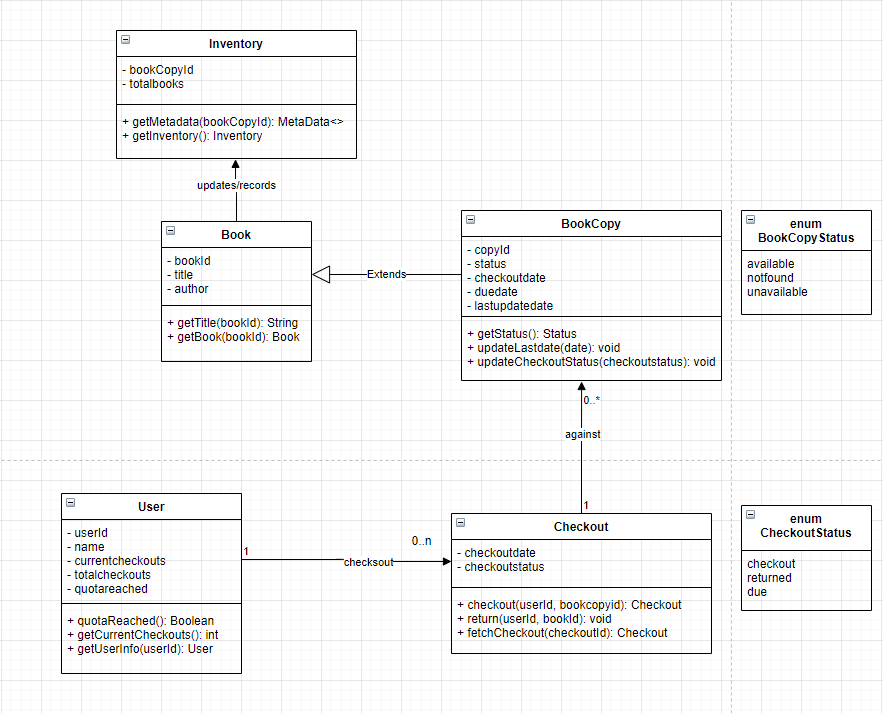
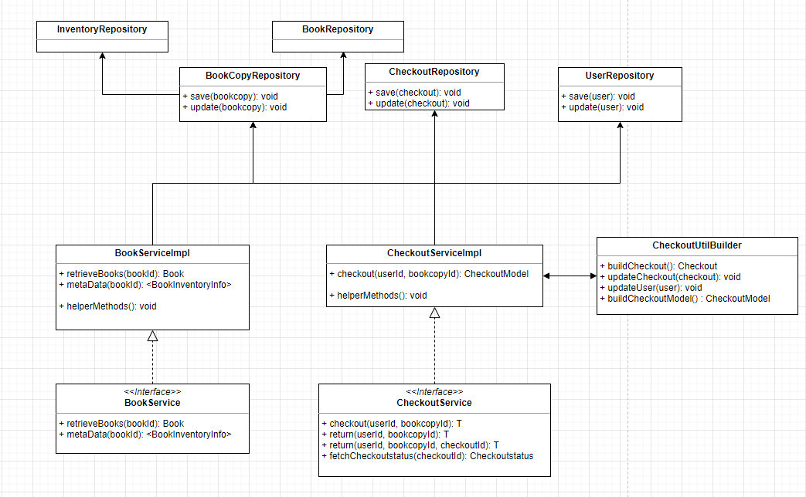
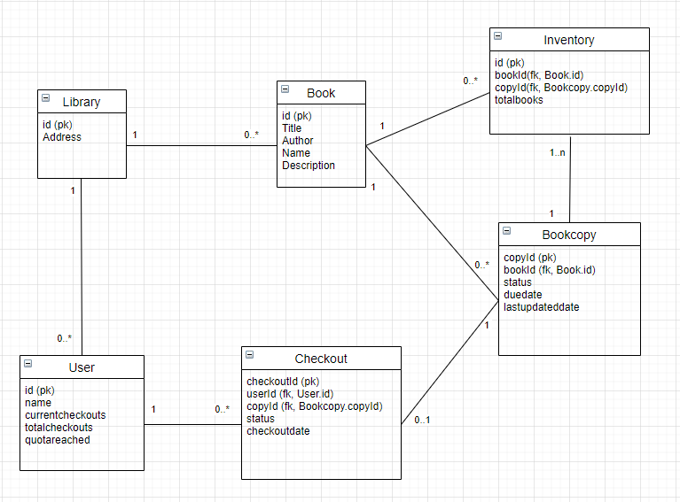

# bibliocommons
Take home assignment

## Library availability system for ebooks

## Part 1

### A user should be able to checkout an ebook if it’s available.

A `POST` HTTP request needs to be made if the user is trying to checkout the ebook if available.

>• The system should be successful if a user checks out an available ebook.<br/>
• The system should keep track of which copy is checked out to which user. The system should always assign the user the oldest available copy. It should mark the copy as checked out and update its timestamp at every checkout.<br/>

`POST /users/{user-id}/checkouts`

**Checkout an ebook 10001 at 1pm on Feb 1 for one week**

#### Request uri, header and payload 

```
POST /users/78965/checkouts HTTP

Headers:
Content-Type: application/json

Request-body:
{
  "data": [
    {
      "book": {
        "id": 10001,
        "checkoutDate": "01-02-2020T13:00:00.000"
      },
      "duration": {
        "days": 7
      }
    }
  ]
}
```

#### Response body

```
201 OK
content-type: application/json 

Response-body:
{
  "data":[
    {
      "checkoutId": "90001",
      "user": {
        "id": "78965",
        "currentCheckout", 1,
        "maxCheckout": 10,
        "quotaReached": false
      },
      "checkoutBooks": [
        {
          "id": 10001,
          "copyId": 10,
          "checkoutDate": "01-02-2020T13:00:00.000",
          "dueDate": "08-02-2020T13:00:00.000",
          "lastUpdatedDate": "01-01-2020T13:00:00.000",
          "status": "checked-out"
        }
      ]
    }
  ]
}

```

**Note:** By making 'checkouts' an array we can do multiple checkouts of books at one time.
Intention is being we can checkout multiple ebooks at once rather than calling/making each call of each book. Advantage here is reducing calls and processing all at once.

>• The system should return an error for a user or an ebook that doesn’t exist.<br/>

If user `77896` is not in the system

#### Request

`POST /users/77896/checkouts HTTP`

Ignoring the payload

#### Response

`404 NOT FOUND`

Since user is not in the system, return a 404.

If ebook 10005 is not in the system

#### Request uri, header and payload 

```
POST /users/78965/checkouts HTTP

Headers:
Content-Type: application/json

Request-body:
{
  "data": [
    {
      "book": {
        "id": 10005,
        "checkoutDate": "01-02-2020T13:00:00.000"
      },
      "duration": {
        "days": 7
      }
    }
  ]
}
```

#### Response

```
422 Unprocessable Entity
content-type: application/json 

Response-body:
{
  "message": "Unprocessable Entity",
  "errors": [
    {
      "resource": "data[0].book",
      "field": "id",
      "message": "book not found in the system",
      "code": "not_found"
    }
  ]
}

```

Give a 422 as unprocessible entity, since the bookIdentifier/ebook does not exist in the system.  


>• The system should return an error if the ebook is checked out to the user already.<br/>

#### Request uri, header and payload 

```
POST /users/78965/checkouts HTTP

Headers:
Content-Type: application/json

Request-body:
{
  "data": [
    {
      "book": {
        "id": 10001,
        "checkoutDate": "01-02-2020T13:00:00.000"
      },
      "duration": {
        "days": 7
      }
    }
  ]
}
```

#### Response body

```
422 Unprocessable Entity
content-type: application/json 

Response-body:
{
  "message": "Unprocessable Entity",
  "errors": [
    {
      "resource": "data[0].book",
      "field": "id",
      "message": "book is already assigned to user",
      "code": "assigned"
    }
  ]
}

```

If trying to assign the same ebook (being a resource), we raise a 422 to notify it is already assigned to the user.

>• The system should keep track of a user’s checkout quota. A user can only have a maximum of 10 checkouts. The system should return an error if the user is about to exceed their checkout quota.<br/>

**Reaching or reached checkouts quota**

#### Request uri, header and payload 

```
POST /users/78965/checkouts HTTP

Headers:
Content-Type: application/json

Request-body:
{
  "data": [
    {
      "book": {
        "id": 10001,
        "checkoutDate": "01-02-2020T13:00:00.000"
      },
      "duration": {
        "days": 7
      }
    }
  ]
}
```

#### Response body

```
201 OK
content-type: application/json 

Response-body:
{
  "data":[
    {
      "checkoutId": "90001",
      "user": {
        "id": "78965",
        "currentCheckout", 10,
        "maxCheckout": 10,
        "quotaReached": false
      },
      "checkoutBooks": [
        {
          "id": 10001,
          "copyId": 10,
          "checkoutDate": "01-02-2020T13:00:00.000",
          "dueDate": "08-02-2020T13:00:00.000",
          "lastUpdatedDate": "01-01-2020T13:00:00.000",
          "status": "checked-out"
        }
      ]
    }
  ]
}

```

Still allow to checkout ebooks, but trigger quotaReached to true. So consumer is aware of their quota being filled in.

**What if they reached reached max checkouts, checking out 11th ebook**

#### Request uri, header and payload 

```
POST /users/78965/checkouts HTTP

Headers:
Content-Type: application/json

Request-body:
{
  "data": [
    {
      "book": {
        "id": 10001,
        "checkoutDate": "01-02-2020T13:00:00.000"
      },
      "duration": {
        "days": 7
      }
    }
  ]
}
```

#### Response body

```
422 Unprocessable Entity
content-type: application/json 

Response-body:
{
  "message": "Unprocessable Entity",
  "errors": [
    {
      "resource": "data[0].book",
      "field": "id",
      "message": "Exceeded max checkout quota",
      "code": "quota_reached"
    }
  ]
}

```

Used 422 response code to notify exceeded max checkouts quota.


>• The system should return an error if the ebook is unavailable.<br/>

If ebook 10005 is unavailable

#### Request uri, header and payload 

```
POST /users/78965/checkouts HTTP

Headers:
Content-Type: application/json

Request-body:
{
  "data": [
    {
      "book": {
        "id": 10005,
        "checkoutDate": "01-02-2020T13:00:00.000"
      },
      "duration": {
        "days": 7
      }
    }
  ]
}
```

#### Response

```
422 Unprocessable Entity
content-type: application/json 

Response-body:
{
  "message": "Unprocessable Entity",
  "errors": [
    {
      "resource": "data[0].book",
      "field": "id",
      "message": "book is unavailable",
      "code": "unavailable"
    }
  ]
}

```

Give a 422 as unprocessible entity, since the bookIdentifier/ebook is unavailable.

`Note:` There seems a lot of 422 being raised. I want the client to understand the root cause of failure. Clients can parse the error response and get to know the state and the error being raised.<br/>
The 422 (Unprocessable Entity) status code means the server understands the content type of the request entity, and the syntax of the request entity (which is correct, if not 400 (Malformed request) is raised) but was unable to process the payload.


### A user should be able to return their ebook that they have checked out.


>• The system should be successful if a user returns an ebook that they have checked out.
• The system should mark the corresponding checked out copy as available and update its timestamp.
• The system should decrease a user’s checkout quota.

We can pretty much do a `PUT` call here, since it is being updated


`PUT /users/{user-id}/checkouts/{checkout-id}`

**Returns the ebook 10001 at 1pm on Feb 2**

#### Request uri, header and payload 

```
PUT /users/78965/checkouts/90001 HTTP

Headers:
Content-Type: application/json

Request-body:
{
  "data": [
    "book": {
      "id": 10001,
      "returnDate": "02-02-2020T13:00:00.000"
    }
  ]
}
```

#### Response body

```
201 OK
content-type: application/json 

Response-body:
{
  "data":[
    {
      "checkoutId": "90001",
      "user": {
        "id": "78965",
        "currentCheckout", 0,
        "maxCheckout": 10,
        "quotaReached": false
      },
      "checkoutBooks": [
        {
          "id": 10001,
          "copyId": 10,
          "checkoutDate": null,
          "dueDate": null,
          "lastUpdatedDate": "02-02-2020T13:00:00.000",
          "status": "available"
        }
      ]
    }
  ]
}
```

Updates the User quota and marks the ebook as available.

>• The system should return an error for a user or an ebook that doesn’t exist.

If user 78965 not found, return 404

#### Request 

`PUT /users/78965/checkouts/90001 HTTP`

#### Response

`404 NOT FOUND HTTP`

***
***
## Let to answer the above
***
***
***


>• The system should return an error if the user returns an ebook that they haven’t checked out.

#### Request uri, header and payload 

```
PUT /users/78965/checkouts/90001 HTTP

Headers:
Content-Type: application/json

Request-body:
{
  "data": [
    "book": {
      "id": 10001,
      "returnDate": "02-02-2020T13:00:00.000"
    }
  ]
}
```

#### Response

```
404 NOT FOUND HTTP
```

If there is no checkout for the ebook which checkout is not made for, we can simply put 404 since no relation/checkout was made on the ebook to the user.


### Retrieve the availability of an ebook.

Following through this:

>•The system should return the following required attributes successfully of an ebook: 
 <br/>o Total Copies
 <br/>o Available Copies
 <br/>o Ebook metadata url (this would be a url link to an API to retrieve ebook metadata) <br/>
• The system should return an error if the ebook doesn’t exist.

We need to design a retrieval service for an ebook. It will be a `GET` HTTP request.

Books will be the resource to find, either by book-identifier-number or by keywords. 

Let's design both requests to retrieve ebook(s)

1. Get ebook by book number.

`GET /books/book-identifiers/{book-identifier-number}`

**Search an ebook 10001**

#### Request

`GET /books/book-identifiers/10001 HTTP`

#### Response body

```
200 OK
content-type: application/json 

{
  "data": [
    "book": {
      "title": {
        "bookId": "10001",
        "name": "Coding Principles,
        "author": "Jim browning",
        "description": "Describing coding principles."
      },
      "inventory": {
        "total": 40,
        "available": 30,
        "reserved": 5,
        "loaned": 10
      },
      "_links":{
        "metadata":{
          "href":"https://some-library-system/books/book-identifiers/10001/metadata"
        }
      }
    }
  ]
}
```

From the above response we can see, an ebook with title and inventory information is retrieved. And reference to books metadata is also mentioned.


2. Get ebook by keywords.

`GET /books/search?keywords={keywords1}+{keywords2}+....`

**Search an ebook with Coding principles**

#### Request

`GET /books/search?keywords=Coding+Principles HTTP`

#### Response body

```
200 OK
content-type: application/json 

{
  "data": [
    "book": {
      "title": {
        "bookId": "10001",
        "name": "Coding Principles",
        "author": "Jim browning",
        "description": "Describing coding principles."
      },
      "inventory": {
        "total": 40,
        "available": 30,
        "reserved": 5,
        "loaned": 10
      },
      "_links":{
        "metadata":{
          "href":"https://some-library-system/books/book-identifiers/10001/metadata"
        }
      }
    },
    "book": {
      "title": {
        "bookId": "10023",
        "name": "Architecture and Coding Principles",
        "author": "George fleming",
        "description": "Standard architecture and coding."
      },
      "inventory": {
        "total": 20,
        "available": 20,
        "reserved": 1,
        "loaned": 0
      },
      "_links":{
        "metadata":{
          "href":"https://some-library-system/books/book-identifiers/10023/metadata"
        }
      }
    }
  ]
}
```

**Search an ebook 70007**

#### Request

`GET /books/book-identifiers/70007`

#### Response body

```
404 Not found
```

Instead of an error, return a not found and let the client handle it gracefully.

***

## Part 2

>• Code package and class layout <br/>
• Database entities and their relationships between each other <br/>
• Explanation of your design and why you chose to go with this design. Feel free to document any assumptions you have made. <br/>

### Class diagrams

Going by worflow of checking out ebooks if available, return the checked ebook and retrieve availability of the ebook.

Designed the below Class and ER diagrams.



Library: The central part of the system

Book: The basic building block of the system. Every book will have id, Title, Publishers, etc.

Bookcopy: Any book can have multiple copies, each copy will be considered a bookcopy in the system. Each bookcopy item will have a unique id.

User: Will be a general consumer of the library system.

Checkout: Responsible for managing checkouts against books. Checkout the books and return the books

Inventory: It has the metadata for the books.




We have classes (layout) related to each interaction.

1. One user can make either 0 or N reservations by calling `checkout` method.
2. User can `return` book either by book-id or checkout-id
3. User can find out their checkout quota
4. Checkout is made against a bookcopy [book copy represents a copy of the book, there can be multiple copies], checkout can be made against 0 or any number of books.
5. Bookcopy extends a Book. Bookcopy has the relation between a book and manifestation of the book.
6. Inventory keeps track of book and bookcopy records, provide metadata if needed (with combination of other classes).
7. Have dedicated enums for BookcopyStatus and CheckoutStatus.
8. Interface CheckoutService has the services for checkout. Interface BookService has book, inventory services.
9. Implementations are accompanied by helper classes for conversions or creation of models.


### Entity-Relation diagrams



The diagram above shows the business objects used in this API as well as their relationships. The library stocks many books. Each book can have several copies - represented by the Bookcopy objects. Each Bookcopy has a unique identification. The library has many Users. Each User can checkout an ebook. The attributes of a checkout are represented by the Checkout object. When a User does a checkout the associated class objects are created and data is inserted along after validations. Similarly Book and Inventory provides inforation and metadata for the books.


## Part 3

>3) Based on the design document, the last task is to provide a concrete code implementation for one user workflow, specifically “A user should be able to checkout an ebook if it’s available”. You should include the following:<br/>
• All the business requirements for this workflow<br/>
• Appropriate tests for your implementation<br/>
You should implement the service interface below:<br/>
public interface CheckoutService<T> {<br/>
    T checkout(long userId, long bookId);<br/>
}<br/>
Your code does not need to be runnable, but it does need to compile.<br/>
Note: Feel free to provide an abstraction to the underlying datastore that describes the underlying calls it would be making.<br/>
Follow up: How would you ensure the checkout operation is concurrent? For example, there is one available copy left for a popular ebook and many users are trying to check it out at the same time. Describe your solution.<br/>

Code snippet for CheckoutService, additional code and project structure is added to the repo.
```
/**
 * The system should be successful if a user checks out an available ebook. 
 * • The system should keep track of which copy is checked out to which user. The system should always assign the user the oldest available copy. 
 * It should mark the copy as checked out and update its timestamp at every checkout. 
 * • The system should return an error for a user or an ebook that doesn’t exist.
 * • The system should return an error if the ebook is checked out to the user already. 
 * • The system should keep track of a user’s checkout quota. A user can only have a maximum of 10 checkouts. The system should return an error if
 * the user is about to exceed their checkout quota. 
 * • The system should return an error if the ebook is unavailable.
 *
 */
@Service
public class CheckoutServiceImpl implements CheckoutService<CheckoutModel> {

	private static final int CHECKOUT_QUOTA = 10;

	@Autowired
	private CheckoutRepository checkoutRepository;

	@Autowired
	private BookRepository bookRepository;

	@Autowired
	private UserRepository userRepository;

	@Autowired
	private CheckoutUtilBuilder checkoutUtilBuilder;

	@Override
	public CheckoutModel checkout(long userId, long bookId) {

		/*
		 * User does not exist
		 */
		if (!userRepository.isValidUser(userId)) {
			throw new UserNotfoundException("user not found.");
		}

		/*
		 * Book does not exists
		 */
		if (!bookRepository.found(bookId)) {
			throw new BookNotfoundexception("book not found.");
		}

		/*
		 * Book is unavailable
		 */
		if (!bookRepository.available(bookId)) {
			throw new BookNotfoundexception("book not available.");
		}

		User user = userRepository.getUser();

		/*
		 * User reached their quota
		 */
		if (user.getUserCheckoutCount() > CHECKOUT_QUOTA) {
			throw new UserExceptions("User reached checkout quota");
		}
		if (user.getUserCheckoutCount() == CHECKOUT_QUOTA) {
			// mark quota to full.
		}

		/*
		 * Check the status of the book for the user
		 */
		CheckoutStatus checkoutStatus = bookRepository.getCheckoutStatus(userId, bookId);

		/*
		 * Book is already checked out by user
		 */
		if (checkoutStatus == CheckoutStatus.CHECKEDOUT) {
			throw new AlreadyAssignedException("User already checkedout");
		}

		/*
		 * Book is available, gets an old copy
		 */
		Bookcopy bookcopy = bookRepository.getAvailableBookCopy(bookId);

		/*
		 * Build a relation between user and books.
		 */
		Checkout checkout = checkoutUtilBuilder.buildCheckout(userId, bookcopy);

		/*
		 * Create a relation between user and books into database.
		 */
		checkoutRepository.save(checkout);

		/*
		 * Mark the copy as checked out and update its timestamp at every checkout.
		 */
		checkout = checkoutUtilBuilder.updateCheckout(checkout.getCheckoutId(), CheckoutStatus.CHECKEDOUT, Instant.now());

		/*
		 * Update the checkout row
		 */
		checkoutRepository.update(checkout);

		/*
		 * Update the user quota and checkout count
		 */
		user = checkoutUtilBuilder.updateUser(user);

		/*
		 * Update the user row
		 */
		userRepository.update(user);

		/*
		 * Every thing is now validated and data is created and mapped, all it needs is
		 * to do is build and return checkout model
		 */
		return checkoutUtilBuilder.buildCheckoutModel(user, checkout);
	}

	@Override
	public CheckoutModel returnbook(long userId, long bookCopyId) {
		// TODO Auto-generated method stub
		return null;
	}

	@Override
	public CheckoutModel returnbook(long userId, long bookCopyId, long checkoutId) {
		// TODO Auto-generated method stub
		return null;
	}

}

```

